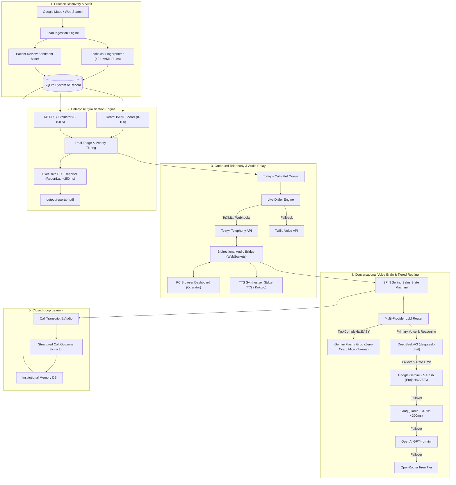

# System Architecture & Technical Specification

## 1. System Overview

The **Enterprise Dental Sales Intelligence & Autonomous Telephony Platform** is an end-to-end B2B revenue acceleration engine tailored for high-ticket dental practices (implants, clear aligners, cosmetic procedures, and after-hours emergency capture).

The system integrates five foundational pillars into a cohesive operational workflow:
1. **Autonomous Lead Discovery & Web Scraping**: Ingests dental practices by metro territory, extracts clinic metadata, and detects practice leadership (doctor/owner names, office managers).
2. **Deep Digital Maturity & Technical Fingerprinting**: Inspects website DOM, script bundles, and HTTP headers across 40+ rules to detect EHR systems, online scheduling tools, and missing patient intake mechanisms.
3. **Enterprise BANT + MEDDIC Qualification**: Translates raw evidence into structured qualification scores (0–100 BANT and 0–100% MEDDIC completeness) with quantified financial leakage models.
4. **Autonomous Voice Telephony & Bidirectional Audio Relay**: Outbound calling via Telnyx TeXML and Twilio, streaming bidirectional audio between phone lines and PC browsers with real-time speech synthesis.
5. **Multi-Provider LLM Resilience & Tiered Cost Routing**: DeepSeek-V3 as Primary Brain for voice & reasoning with cost-tier offloading (EASY $\rightarrow$ Gemini Flash/Groq micro-budget; COMPLEX $\rightarrow$ DeepSeek) and graceful circuit-breaker failover (DeepSeek $\rightarrow$ Gemini Projects A/B/C $\rightarrow$ Groq $\rightarrow$ OpenAI $\rightarrow$ OpenRouter).

---

## 2. Component Architecture Diagram

---

## 3. Subsystem Breakdown

### 3.1. Lead Discovery & Technical Fingerprinting
- **Module**: `scanner.py`, `models.py`, `rules/*.yaml`
- **Mechanism**: Fetches target website HTML and headers. Evaluates against declarative YAML rules for:
  - Practice Management Systems: Dentrix, Eaglesoft, Open Dental, Curve Dental
  - Patient Engagement & VoIP: Weave, Podium, RevenueWell, NexHealth
  - Scheduling Tools: LocalMed, NexHealth, DentalXChange, Acuity
  - Analytics & Pixels: GA4, GTM, Meta Pixel, Google Ads Tag
  - CMS: WordPress, Webflow, Squarespace, Wix, Drupal
- **Evidence Graph**: Emits polymorphic evidence instances (DOM element, script tag, HTTP header, network URL) with deterministic confidence scores (0–99%).

### 3.2. BANT & MEDDIC Enterprise Qualification
- **Module**: `bant_meddic_scorer.py`
- **BANT Scoring Dimensions (0–100)**:
  - **Budget (0–25)**: Software spend indicators + high-ticket clinical services (Implants, Veneers, Invisalign, Sedation) + practice operatory scale.
  - **Authority (0–25)**: Verifies Dr. Owner identity, practice management structure, and single-owner decision speed.
  - **Need (0–25)**: Quantifies trapped after-hours patient flow and negative Google review complaints (unanswered calls, hold times).
  - **Timeline (0–25)**: Hiring signals, seasonal procedure surges, and competitive local adoption pressure.
- **MEDDIC Completeness Dimensions (0–100%)**:
  - **M**etrics: Quantified annual financial leakage (\$EV).
  - **E**conomic Buyer: Verified owner dentist.
  - **D**ecision Criteria: PMS / EHR compatibility.
  - **D**ecision Process: Independent owner vs DSO corporate board.
  - **I**dentify Pain: Documented front desk intake bottlenecks.
  - **C**hampion: Practice office manager or front desk coordinator.

### 3.3. Publication-Grade Vector PDF Dossier Generation
- **Module**: `executive_pdf_reporter.py`
- **Engine**: ReportLab 5.0+ vector graphics engine.
- **Performance**: Generates complete 2-page publication-quality dossiers in **~250ms** with zero headless browser / Playwright dependencies.
- **Contents**:
  - Clinic Executive Overview and Metadata
  - Financial Leakage & Chair-Time Loss Model
  - BANT & MEDDIC Radar Breakdown
  - Operational Bottlenecks & Missing After-Hours Technology
  - 30-Day Patient Recovery Roadmap

### 3.4. Autonomous Voice Telephony & Audio Bridge
- **Module**: `voice_dialer.py`, `live_dialer_engine.py`, `audio_bridge.py`
- **Supported Telephony Carriers**:
  - **Telnyx** (Primary): Uses TeXML REST API and WebSocket streaming for bi-directional audio relay.
  - **Twilio** (Secondary): Uses TwiML Voice REST API and Media Streams.
- **Dual Dialing Modes**:
  - `HUMAN_FIRST` (Default): Connects outbound call, plays ringing audio to PC speaker, displays live speech-to-text transcription, and allows operator whisper/takeover.
  - `AI_FIRST`: Connects outbound call directly to the conversational AI voice receptionist on ring 1.
- **Speech Synthesis**:
  - **Edge-TTS**: Cloud-based Microsoft neural TTS (`en-US-AvaNeural`), asynchronous non-blocking synthesis.
  - **Kokoro ONNX**: Local CPU neural TTS model running offline without cloud API overhead.

### 3.5. Multi-Provider LLM Router, Primary DeepSeek Brain & Tiered Routing
- **Module**: `llm_router.py`
- **Architecture**: Decoupled multi-project, multi-provider circuit-breaker router with intelligent cost-tiered task routing (`TaskComplexity`).
- **Primary Brain**: **DeepSeek-V3** (`deepseek-chat`) handles conversational voice dialogue, BANT/MEDDIC reasoning, sales strategy, and proposal extraction.
- **Intelligent Cost-Tier Routing**:
  - `TaskComplexity.EASY` (sentiment analysis, entity classification, phone normalization): Automatically offloaded to **Google Gemini 2.5 Flash** (free tier) or **Groq** (`llama-3.1-8b-instant`) with strict $\le 250$ max token bounds, preserving DeepSeek tokens and maximizing speed.
  - `TaskComplexity.CONVERSATION` & `COMPLEX`: Directly powered by **DeepSeek-V3** (`deepseek-chat`).
- **Cascade Fallback Strategy (on 429 rate limit or network error)**:
  1. **DeepSeek** (`deepseek-chat`): Primary enterprise reasoning and voice dialogue model.
  2. **Google Gemini 2.5 Flash**: Seamless failover across up to 3 Google AI projects (Project A $\rightarrow$ B $\rightarrow$ C).
  3. **Groq** (`llama-3.3-70b-versatile`, ultra-low latency $<300\text{ms}$): Engaged if primary models encounter rate limits.
  4. **OpenAI** (`gpt-4o-mini`): High-accuracy fallback.
  5. **OpenRouter** (`meta-llama/llama-3.3-70b-instruct:free`): Zero-cost multi-model aggregator.

### 3.6. Consultative Sales Orchestration
- **Module**: `sales_state_machine.py`, `empathy_voice_prompts.py`
- **Framework**: Consultative **SPIN Selling**:
  - `SITUATION`: Confirm clinic scale, operatory count, and practice management tools.
  - `PROBLEM`: Uncover unreturned after-hours calls and front desk morning telephone backlogs.
  - `IMPLICATION`: Quantify the financial cost of lost high-ticket implant and emergency patients.
  - `NEED_PAYOFF`: Offer automated 24/7 patient capture and demo lock-in.
- **Tool Calling**:
  - `check_calendar_availability`: Checks live demo slots.
  - `book_demo_appointment`: Locks in date, time, and attendee email.
  - `send_whatsapp_diagnostic`: Dispatches clinic diagnostic link.

---

## 4. Data Storage & Schema Design

- **Database**: SQLite with Write-Ahead Logging (`PRAGMA journal_mode=WAL`) and 30-second busy timeout for high-concurrency read/write operations.
- **Master Tables**:
  - `leads`: Core entity (name, doctor, phone, rating, reviews, opportunity score, BANT/MEDDIC scores).
  - `audits`: Historical snapshots of technical audits, tech stack, and content hashes.
  - `technologies`: Normalized detected software tools per audit.
  - `findings`: Empirical evidence and confidence scores.
  - `insights`: Executive business reality translations.
  - `changes`: Audit-to-audit shift tracking (tech added/removed, content changed).
  - `call_recordings`: Full transcripts, durations, handoffs, and call outcomes.
  - `institutional_memories`: Multi-call learning repository per practice.
  - `opportunity_timeline`: Complete chronological lifecycle event ledger.
